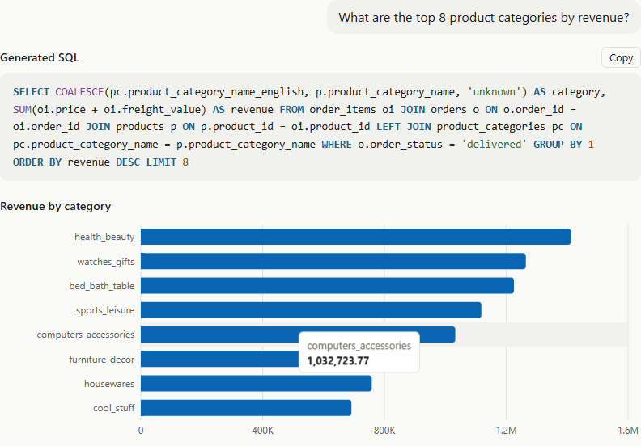
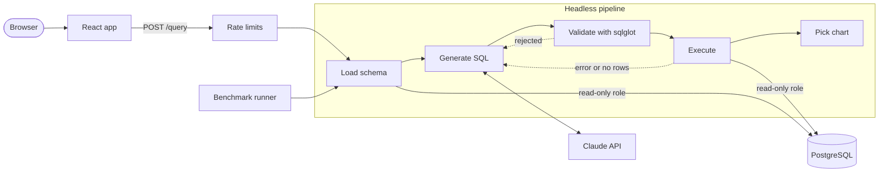

# QueryPilot

**Ask a database questions in plain English, and get safe, read-only SQL, results, and a chart.**

[](https://github.com/salexm/querypilot/actions/workflows/ci.yml)
[](LICENSE)


**Live demo:** coming soon

<!-- Replace this image with docs/images/demo.gif when the demo is recorded. -->


## Features

- **Natural language to SQL:** Claude writes PostgreSQL from the live database schema.
- **Layered safety:** A read-only role, a parsing validator, a statement timeout, and a row cap all guard generated SQL.
- **Self-correction:** SQL errors and empty results go back to the LLM, with up to 2 retries.
- **Automatic charts:** Rules pick a line or bar chart from the column types, or no chart when one would mislead.
- **Execution-based benchmark:** 123 questions are scored by comparing result sets, not SQL text.
- **Protected credits:** Per-visitor and daily limits stop a public demo from spending your API budget.
- **One-command setup:** `docker compose up` starts everything and loads the data.

## Architecture



The API and the benchmark call the same pipeline, so benchmark scores measure the code users actually run.

## Benchmark results

The benchmark has 123 questions with gold SQL. Generated SQL counts as correct when its result set matches the gold result set.

| Difficulty | Questions | Claude Opus 5.5 | Claude Haiku 5.5 |
|---|---:|---:|---:|
| Easy | 42 | 100.0% | 100.0% |
| Medium | 45 | 100.0% | 100.0% |
| Hard | 36 | 100.0% | 97.2% |
| **Overall** | **123** | **100.0%** | **99.2%** |

| Measure | Claude Opus 5.5 | Claude Haiku 5.5 |
|---|---:|---:|
| Median latency | 1.9s | 1.7s |
| Cost per full run | about $1.33 | about $0.04 |

Each model ran each question once, without self-correction.

**How to read these numbers:**

- **They're an upper bound.** Opus scored 92.7% on the first run. All 9 misses came from ambiguous wording, such as "how many reviews" (rows or distinct IDs). After I reworded those questions, without changing any gold SQL, it scored 100%.
- **The set is too easy.** Two very different models score almost the same, so it can't yet show improvement.
- **The scorer is checked.** It rejected all 321 deliberately altered answers. Of 6,020 swapped answers, it accepted 5, all explained by its extra-column rule or identical answers.
- **Self-correction shows no measurable gain here.** The baseline is already about 100%: Opus scored 123/123 without it and 122/123 with it, and that one miss involved no retry. On a question that failed before, it recovered in 3 of 3 live tries.

## Tech stack

| Layer | Technology |
|---|---|
| Frontend | React, TypeScript, Vite, TanStack Query, Recharts |
| Backend | Python, FastAPI, Pydantic, psycopg |
| SQL safety | sqlglot |
| LLM | Anthropic Claude, behind a provider adapter |
| Database | PostgreSQL 17 |
| Testing | pytest, Vitest, Testing Library |
| Tooling | Docker Compose, GitHub Actions, ruff, ESLint |
| Hosting | Render and Neon free tiers |

## Quick start

You need Docker and an [Anthropic API key](https://console.anthropic.com).

```bash
git clone https://github.com/salexm/querypilot.git
cd querypilot
cp .env.example .env      # then set LLM_API_KEY and your own passwords
docker compose up --build
```

Open <http://localhost:5173>. The first start downloads and verifies the dataset, and later starts skip that step.

```bash
docker compose exec api pytest                       # backend tests, including attacks on a real database
docker compose exec web npm test                     # frontend tests
docker compose exec api python -m eval.runner        # benchmark (makes real LLM calls)
docker compose exec api python -m eval.runner --compare  # with and without self-correction
```

To deploy your own copy, see [the deployment guide](docs/deployment.md).

## Project structure

```text
querypilot/
├── backend/app/
│   ├── api/          # routes, rate limits, error responses
│   ├── pipeline/     # orchestrator, validator, executor, chart rules
│   ├── llm/          # provider interface and Anthropic adapter
│   ├── schema/       # introspection and prompt formatting
│   └── prompts/      # versioned prompt files
├── frontend/src/
│   ├── api/          # typed client
│   ├── components/   # SQL viewer, results table, chart
│   └── features/query/
├── eval/             # questions, runner, scoring, reports
├── db/               # database roles and dataset seed
├── docs/             # deployment guide and decision records
├── docker-compose.yml
└── render.yaml
```

## Design decisions and tradeoffs

| Decision | Why | Tradeoff |
|---|---|---|
| Database role as the main protection | It still holds if the validator has a bug, and tests confirm attacks fail with the validator skipped | Needs setup on every host |
| Validate by parsing, not regex | Catches a `DELETE` hidden in a `WITH` clause, and allows harmless text such as `'DROP TABLE'` | The function check is a denylist, so it's only a second layer |
| Headless pipeline | The benchmark exercises the real code path | One more layer of indirection |
| Score result sets, not SQL text | Many different queries can be correct | Needs carefully worded questions |
| Chart rules, not LLM choices | Free, instant, testable, and repeatable | Handles only common result shapes |
| In-memory rate limits | No extra service on a single instance | Counters reset on restart, so a provider spend limit is the hard stop |
| Free-tier hosting | $0 for a portfolio demo | The first request after idle can take up to a minute |

Decision records are in [`docs/decisions/`](docs/decisions/).

## Future improvements

- **Harder benchmark:** Add naturally worded questions that aren't tuned against the model, so self-correction can show a real gain.
- **History and traces:** Save each question, its SQL, and its attempts.
- **Follow-up questions:** Carry context between turns of the conversation.
- **Answer verification:** Catch SQL that runs but returns the wrong answer, which retries can't detect.
- **Your own data:** Connect other databases, not just the demo dataset.
- **Durable limits:** Move rate limits to a shared store for multiple instances.

## Dataset and license

The demo uses the [Brazilian E-Commerce Public Dataset by Olist](https://www.kaggle.com/datasets/olistbr/brazilian-ecommerce), licensed under [CC BY-NC-SA 4.0](https://creativecommons.org/licenses/by-nc-sa/4.0/). The raw data isn't stored here, and the seed changes it slightly, as described in [the dataset decision](docs/decisions/0001-demo-dataset.md).

The code is licensed under [MIT](LICENSE). See [CONTRIBUTING.md](CONTRIBUTING.md) to get involved.
